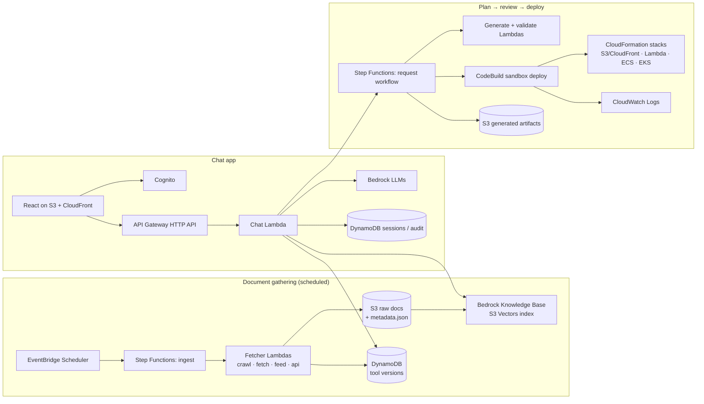

# InfraPilot Development Plan

InfraPilot is an AI DevOps assistant on AWS. It has two halves:

1. **Knowledge**: a RAG chatbot. It answers DevOps questions with citations from current documentation and release notes, and it explains scan results and build failures.
2. **Action**: chat requests in plain English ("set up CI for my Node app") become validated infrastructure-as-code and CI/CD files. The user reviews and approves them, and InfraPilot can deploy them to a sandbox with live logs and one-click teardown.

This plan breaks the work into components and features, orders them into phases, and splits each phase between two pairs (team of 4). We build in this order: **RAG and document gathering** first, local first, then move each piece to AWS.

Source inputs: `InfraPilot Project Proposal.pdf` and the [document sources sheet](https://docs.google.com/spreadsheets/d/1qhb5pxeY7RZiWZd4Ey7J-nUNlBPjoQn1SwntbEyert8/edit?usp=sharing) (59 sources as of 2026-10-09).

---

## 1. Ground rules

| Rule | What it means in practice |
|---|---|
| **Local first** | Every feature runs and passes its tests on a laptop before it touches AWS. Bedrock is the only AWS service we call from day one, because it has no local equivalent. |
| **Feature by feature** | A feature is done when its tests and eval pass locally and in AWS (see each feature's *Done when*). Then we move on. |
| **Everything is code** | All AWS resources live in one AWS CDK app (`infra/`), split into small stacks. Nothing gets created by hand in the console, so anything can be destroyed with one command. |
| **Keep costs low** | We use serverless, pay-per-request services by default, avoid anything billed per hour, and tear down hourly-billed resources (EKS, ALB, Fargate) the same day we test them. See [§8 Cost control](#8-cost-control). |
| **One region** | `us-east-1`. It has the widest Bedrock model availability and supports S3 Vectors. |
| **Tag everything** | `project=infrapilot`, `owner=<pair>`, `lifecycle=persistent\|ephemeral`. Tags drive cost reports and the teardown script. |

### Tech stack

| Layer | Choice | Why |
|---|---|---|
| Backend, ingestion, Lambdas | Python 3.12, `boto3`, `pydantic`, `uv` | Best Bedrock/AWS SDK support, plus good scraping libraries (`httpx`, `trafilatura`, `feedparser`) |
| Infrastructure | AWS CDK v2 (Python) | One language across the backend; it's also what InfraPilot generates for users |
| Frontend | React + TypeScript + Vite | Static build, so it fits S3 + CloudFront |
| Local AWS emulation | LocalStack (community) + `moto` for unit tests | S3, DynamoDB, Lambda, SQS, Step Functions, EventBridge without cost |
| Local vector store | LanceDB (embedded, file-based) | No server needed; we swap it for Bedrock Knowledge Bases later |
| Validators | `cfn-lint`, `checkov`, `actionlint`, `hadolint`, `trivy` | They check generated files. They're also on the ingestion source list, so the RAG can explain their findings |
| Repo CI | GitHub Actions | Unit tests and lint on every PR (no AWS cost) |

### Proposed repo layout

```
infrapilot/
├── docs/                    # this plan, architecture notes, decisions
├── data_collection/         # sources (sheet snapshot + rules), fetchers, normalizer, chunker, version registry
├── rag/                     # retrieval backends (local + Bedrock KB), answer service, prompts
├── assistant/               # intent classifier, clarification/slot filling, artifact generators
├── templates/               # golden templates + guardrail policy (also ingested into the KB)
├── validation/              # linters/scanners wrapper, self-correction loop
├── api/                     # Lambda handlers for the HTTP API
├── workflow/                # Step Functions definitions + task Lambdas (plan/review/deploy/teardown)
├── frontend/                # React app
├── infra/                   # CDK app, one stack per feature area
├── eval/                    # eval datasets, harness, reports
├── samples/                 # sample apps used as deploy targets in tests (node app, static site, lambda)
└── scripts/                 # dev helpers, teardown.sh, cost report
```

---

## 2. Architecture overview



### Components

| # | Component | Responsibility | Main AWS services |
|---|---|---|---|
| C1 | **Source registry** | Turn the Google Sheet into `data_collection/sources/sources.csv`: source id, type, URL, path filters, category | S3 (copy for Lambdas) |
| C2 | **Fetchers** | One per sheet *Type*: `Crawl`, `Fetch`, `Feed`, `API`, `Upload` | Lambda, Step Functions, Secrets Manager (GitHub token) |
| C3 | **Normalizer** | HTML → Markdown, strip navigation, add a metadata sidecar, compute a content hash for change detection | Lambda |
| C4 | **Raw doc store** | Versioned original + normalized docs | S3 |
| C5 | **Version registry** | Latest versions, LTS and EOL facts (Node LTS, `actions/checkout@v*`, CDK, K8s/EKS versions) | DynamoDB |
| C6 | **Knowledge base** | Chunking, embeddings, vector search with metadata filters | Bedrock Knowledge Bases, S3 Vectors, Titan Text Embeddings V2 |
| C7 | **Answer service** | Retrieve → prompt → answer with citations and version facts injected | Bedrock (Converse API, Claude models) |
| C8 | **Chat API** | Sessions, routing (Q&A vs. task vs. explain-failure), auth | API Gateway HTTP API, Lambda, Cognito, DynamoDB |
| C9 | **Intent + clarification** | Classify the request, extract parameters, ask follow-up questions for anything missing | Bedrock (small/fast model) |
| C10 | **Generators** | Produce files per task type from golden templates + RAG + version registry | Bedrock, S3 |
| C11 | **Validation loop** | Lint/scan generated files; feed errors back to the generator for up to N retries | Lambda (container image) or CodeBuild |
| C12 | **Request workflow** | Plan → review → approve → deploy → record, with a human approval step | Step Functions (task token) |
| C13 | **Sandbox deployer** | Run `cdk deploy` / `cloudformation deploy` under a restricted role; stream logs; tear down | CodeBuild, CloudFormation, IAM permission boundary, CloudWatch Logs |
| C14 | **Audit history** | Every request, its generated artifacts, approvals, and deploy outcome | DynamoDB, S3 |
| C15 | **Frontend** | Chat, plan/diff review, approval, live logs, history, teardown button | S3, CloudFront |
| C16 | **Observability + cost guard** | Logs, metrics, alarms, budgets, janitor that deletes stale sandbox stacks | CloudWatch, AWS Budgets, EventBridge Scheduler |

---

## 3. Team split

Two pairs work in parallel. Each pair owns a *vertical* area end to end (local code → tests → CDK stack → cloud test), so they rarely block each other.

| | **Pair A: Knowledge & Generation** | **Pair B: Platform & Delivery** |
|---|---|---|
| Owns | C1–C7, C9–C11 | C8, C12–C16 |
| Short version | What InfraPilot *knows* and *writes* | How users *reach* it and how things get *deployed* |
| AWS focus | S3, Lambda, Step Functions (ingest), DynamoDB, Bedrock, Bedrock KB, S3 Vectors, EventBridge Scheduler | API Gateway, Lambda, Cognito, CloudFront, Step Functions (workflow), CodeBuild, CloudFormation, ECR/ECS/EKS, CloudWatch, Budgets |

In Phase 1, Pair B builds the retrieval/answer layer and eval harness while Pair A builds ingestion. That way RAG work starts in parallel, against a small hand-made doc set, before ingestion is finished.

### Interface contracts (agree in week 1; this is what keeps pairs unblocked)

1. **`NormalizedDoc`**: what ingestion writes and the KB/retriever reads.
   ```json
   {
     "doc_id": "gha-workflow-syntax",
     "source_id": 2,
     "category": "CI/CD – GitHub Actions",
     "title": "Workflow syntax for GitHub Actions",
     "url": "https://docs.github.com/en/actions/reference/...",
     "fetched_at": "2026-10-12T03:00:00Z",
     "content_hash": "sha256:…",
     "doc_type": "reference | release_note | rule | template | troubleshooting",
     "body_markdown": "…"
   }
   ```
   Stored as `s3://…/normalized/<category>/<doc_id>.md` plus `<doc_id>.md.metadata.json`. That is the sidecar format Bedrock Knowledge Bases uses for metadata filtering.
2. **`Retriever` interface**: `retrieve(query, filters, k) -> list[Chunk{text, url, title, score, metadata}]`, with `LocalLanceRetriever` and `BedrockKBRetriever` implementations.
3. **`VersionRegistry` interface**: `get(tool) -> {latest, lts, eol, source_url, fetched_at}`.
4. **Chat API (OpenAPI)**: `POST /sessions`, `POST /sessions/{id}/messages`, `GET /requests/{id}`, `POST /requests/{id}/approve`, `POST /requests/{id}/teardown`, `GET /requests/{id}/logs`.
5. **`Plan`**: what generators return and the workflow/UI display.
   ```json
   {
     "request_id": "…", "intent": "static_site", "params": {"domain": null, "region": "us-east-1"},
     "files": [{"path": "infra/app.py", "content": "…"}],
     "summary": "…", "validations": [{"tool": "cfn-lint", "status": "pass", "findings": []}],
     "citations": [{"title": "…", "url": "…"}], "estimated_cost_note": "…"
   }
   ```

Working agreements: trunk-based with short PRs; **every PR is reviewed by someone from the other pair** (spreads knowledge); one shared AWS account with per-person IAM Identity Center users; a 15-minute sync twice a week covering contract changes and the cost dashboard.

---

## 4. Phases and features

Timeline assumes ~10 weeks starting the week of **2026-10-12**. Shift the dates to the course deadline; the order and the pair split are what matter.

| Phase | Weeks | Theme | Pair A | Pair B |
|---|---|---|---|---|
| 0 | 1 | Foundations | Source registry, fetcher skeleton | AWS account guardrails, CDK skeleton, repo CI |
| 1 | 1–3 | **Local RAG + document gathering** | Ingestion pipeline (all source types) + version registry | Retriever, answer service, eval harness, CLI chat |
| 2 | 3–4 | **RAG in AWS** | Ingestion on Lambda/Step Functions + Scheduler, KB sync | KB + S3 Vectors stack, chat API on API Gateway, cloud eval |
| 3 | 5–6 | Chat app + generation | Intent, clarification, generators, validation loop | Frontend, Cognito, sessions, hosting, plan review UI |
| 4 | 6–8 | Plan → review → deploy | Container/ECS/EKS generators, explain scan results & build failures | Step Functions workflow, CodeBuild sandbox, logs, teardown, audit |
| 5 | 9 | Hardening + end-to-end eval | Eval sweeps, prompt/chunking tuning | Monitoring, security review, EKS demo run |
| 6 | 10 | Stretch + demo | Stretch goals (cost estimate, Inspector) | Stretch goals (Slack, dashboards), final teardown |

---

### Phase 0: Foundations (week 1, both pairs)

**Pair B: AWS account guardrails (do this before anyone deploys anything)**
- AWS Budgets: monthly budget ($30 suggested) with email alerts at 50/80/100%, plus a $5/day anomaly alert (Cost Anomaly Detection).
- IAM Identity Center users for all 4; no long-lived access keys. GitHub Actions uses OIDC if it ever needs AWS.
- Enable Bedrock model access in `us-east-1`: Titan Text Embeddings V2, a Claude Haiku-class model (routing/classification), and a Claude Sonnet-class model (generation/answers). Model IDs live in config, not code.
- CDK bootstrap; a `infra/` app with an empty `CoreStack`; tagging aspect applied to all stacks.
- Repo CI: `ruff`, `pytest`, `npm test` on PRs.

**Pair A: Source registry + fetcher skeleton**
- `infrapilot-data sync-sources`: downloads the sheet as CSV (`/export?format=csv`) into `data_collection/sources/sources.csv` and validates columns (`#, Category, Document, URL, Type, Filter / Notes`).
- Parse the free-text *Filter / Notes* into structured rules (path allowlists, keyword filters, "latest release → DynamoDB"). Add a `filters` column to the sheet if that gets messy.
- Define `NormalizedDoc` with pydantic and the fetcher base class.

**Both:** agree on contracts 1–5 above; write `docs/decisions/` entries for any deviations from the proposal.

**AWS used:** Budgets, Cost Anomaly Detection, IAM Identity Center, Bedrock (model access only), CDK bootstrap (S3 + IAM).

---

### Phase 1: Local RAG + document gathering (weeks 1–3)

#### Feature 1.1: Document gathering pipeline (Pair A)

| Source type (sheet) | Count | Implementation |
|---|---|---|
| **Fetch** | 29 | Single page via `httpx`. Prefer Markdown sources when they exist: AWS docs `.html → .md`, GitHub `raw.githubusercontent.com`, `github/docs`, `docker/docs`, `kubernetes/website` source trees via the GitHub contents API, filtered by path |
| **Crawl** | 11 | Bounded crawler: use the sitemap if one exists, else breadth-first search within the allowed path prefixes. Honor `robots.txt`, 1 req/s per host, `max_pages` per source (start at 200), skip unchanged pages via ETag/`Last-Modified` |
| **Feed** | 4 | `feedparser`, keyword filters from notes (e.g. keep "actions" items; AWS What's New items that mention our services), 180-day window |
| **API** | 13 | GitHub Releases API → latest tag + README for the 9 action repos and CDK; Node `index.json` → current LTS; Node `schedule.json` → EOL dates; Kubernetes/EKS version pages → supported versions. Facts go to the **version registry**, prose goes to the KB |
| **Upload** | 2 | Team-authored golden templates and guardrail policy from `templates/`, ingested like any other doc |

- **Normalizer:** HTML → clean Markdown (`trafilatura`), drop nav/footer, keep code blocks and tables, add the metadata sidecar, and compute a content hash. If the hash hasn't changed, skip the doc (cheaper re-ingestion).
- **Version registry (local):** DynamoDB Local or LocalStack table `tool_versions` (`pk=tool`).
- **CLI:** `infrapilot-data fetch --source 2`, `--category Containers`, `--max-pages 3`, then `infrapilot-data process`. It writes to `data_collection/data/` locally and to S3 later. **Status: implemented**, see [`data_collection/README.md`](../data_collection/README.md); embedding model choice in [decision 001](decisions/001-embedding-model.md).
- **Coverage gaps in the sheet** (filled by rows #60–80, now in the sheet). The proposal includes features the original sheet had no sources for:
  - Lambda: Lambda Developer Guide (runtimes, deployment packages, Node.js handler), CloudFormation `AWS::Lambda::*`, the Lambda runtimes/deprecation table (into the version registry)
  - Static site: S3 static website hosting, CloudFront with an S3 origin (OAC), CloudFormation `AWS::CloudFront::*`
  - EKS autoscaling: Cluster Autoscaler or Karpenter docs, `eksctl` config file schema
  - Buildspec/workflow failure explanations: GitHub Actions troubleshooting/"Monitoring and troubleshooting workflows"
- The sheet targets ECS/Fargate for containers and marks EKS as stretch, while the proposal lists EKS as a core task. See [§9 Decisions](#9-open-decisions).

**Tests:** unit tests per fetcher with recorded HTTP fixtures (`respx`/`vcrpy`); normalizer golden-file tests; filter tests (e.g. only `/en/actions/reference/` paths crawled); idempotency test (second run uploads 0 changed docs).
**Done when:** `--all` completes locally; every sheet row produces ≥1 doc or a logged, explained skip; ingestion report shows docs/source, bytes, and failures; version registry has Node LTS, latest `actions/checkout`, `setup-node`, CDK, and EKS versions.

#### Feature 1.2: Retrieval + answers with citations (Pair B)

- Start on a **hand-picked seed set** of ~30 docs (workflow syntax, Dockerfile reference, ECS troubleshooting, etc.) so this work doesn't wait for Feature 1.1. Switch to the full ingestion output when it lands.
- `LocalLanceRetriever`: chunking (start with ~500 tokens, 15% overlap, split on Markdown headings), embeddings via **Bedrock Titan Text Embeddings V2** (same model as the cloud KB, so results are comparable; costs cents), stored in LanceDB.
- Answer service: Bedrock Converse API with a system prompt that requires citations. Every claim maps to a retrieved chunk URL, and the model says "not in the docs" instead of guessing. The current version registry facts are injected into the prompt.
- Metadata filters by category, so a GitHub Actions question doesn't retrieve Kubernetes chunks.
- CLI chat: `infrapilot-ask "What's the latest setup-node version and how do I cache npm?"`

**Tests:** retriever unit tests on a fixed mini-corpus; prompt snapshot tests; "refuses when docs don't contain the answer" test.

#### Feature 1.3: RAG evaluation harness (Pair B builds it, both pairs write questions)

- `eval/rag/questions.jsonl`: **≥60 questions** spread across sheet categories, each with expected source URL(s) and key facts. About 10 should be version questions ("current Node LTS?") whose answers are checked against the version registry, and about 10 should be unanswerable to test refusals.
- Metrics:
  - **Retrieval:** hit@5 and MRR against the expected URLs
  - **Citation accuracy:** cited URLs ⊆ retrieved URLs, and at least one expected URL cited
  - **Faithfulness/correctness:** LLM-as-judge (Claude Sonnet-class model, rubric 1–5) plus exact match on key facts
  - **Version correctness:** the version in the answer equals the registry value
  - **Refusal accuracy** on unanswerable questions
  - **Latency** (p50/p95) and **cost per answer** (tokens × price)
- Output: `eval/reports/<date>-<backend>.md` so we can compare chunking strategies and local vs. cloud.

**Phase 1 targets:** hit@5 ≥ 0.8, citation accuracy ≥ 0.9, version correctness = 1.0, refusal accuracy ≥ 0.8.

**Status: implemented** in [`eval/`](../eval/README.md): 79 questions (59 answer, 10 version, 10 refusal). Baseline
(2026-10-12, local LanceDB + gpt-5.4-mini): hit@5 0.88 ✅, citation accuracy 0.89 ❌, version correctness 1.00 ✅,
refusal accuracy 1.00 ✅, 3 false refusals, ~$0.003/answer. Most failures are retrieval misses in CloudFormation and CDK. With **hybrid search** (vector + keyword, reciprocal rank fusion): hit@5 0.95, citation accuracy 0.96, version
correctness 1.00, refusal accuracy 1.00, so all four targets pass. After fixing wrong refusals (partial answers
instead of refusing, best passage per page, sheet source name in chunk headers): 0 false refusals, refusal accuracy 0.90.
With **reranking** (Cohere Rerank 3.5 on Bedrock, [decision 003](decisions/003-reranker.md)): hit@5 0.98, citation accuracy 0.98,
version correctness 1.00, refusal accuracy 1.00, 1 failure out of 79. Reranking is now **off by default** to avoid per-query
cost; the default (hybrid) setup still meets all four targets. ⚠️ For Phase 2, check whether Bedrock KB hybrid search
works with an S3 Vectors store; if not, the cloud retriever needs its own keyword step to match local results.

**AWS used in Phase 1:** Bedrock only (embeddings + LLM). Everything else is local (LanceDB, LocalStack/DynamoDB Local, files on disk).

---

### Phase 2: RAG in AWS (weeks 3–4)

#### Feature 2.1: Cloud ingestion (Pair A)
- `StorageStack`: S3 bucket `infrapilot-docs-<acct>` (versioning on, lifecycle rule expiring old versions after 30 days, block public access), DynamoDB `tool_versions` + `ingest_state` (on-demand).
- `IngestionStack`:
  - Step Functions (Standard) runs a `Map` over `sources.csv` → per-source fetcher Lambda (max concurrency 5) → normalize → write S3. Crawl sources fan out per page batch so no Lambda nears the 15-minute limit.
  - At the end it calls `bedrock-agent:StartIngestionJob` (incremental sync: only changed/deleted S3 objects are re-embedded).
  - **EventBridge Scheduler**: release/version sources (API + Feed) **daily**, full docs (Crawl + Fetch) **weekly**. Both stay disabled until the manual run passes.
  - GitHub token in **Secrets Manager**, or SSM Parameter Store SecureString, which is free.
- **Test:** run the same CLI against LocalStack first (S3/DynamoDB/Step Functions), then a real deploy with `--category` limited to one category, then all.

#### Feature 2.2: Bedrock Knowledge Base + cloud retrieval (Pair B)
- `KnowledgeStack`: **Bedrock Knowledge Base with an S3 Vectors vector bucket/index** and the S3 docs bucket as data source. Chunking settings match what won in the Phase 1 eval, with metadata filtering on `category` and `doc_type`.
  - ⚠️ Do **not** pick OpenSearch Serverless as the vector store (the console quick-create default in some flows). It has a large always-on minimum cost. S3 Vectors is pay-per-use.
- `BedrockKBRetriever` implements the same `Retriever` interface via the `Retrieve` API. The answer service is unchanged.
- `ApiStack`: API Gateway HTTP API → `chat` Lambda (`POST /ask` for now). HTTP API has a 30 s integration timeout, so keep answers short or move to Lambda response streaming (Function URL) in Phase 3 if p95 latency gets close.
- **Eval:** run the Phase 1 harness against the KB backend. **Target: within 5 points of the local scores**; differences point to chunking/parsing configuration.

**Done when:** the scheduled ingestion runs unattended for 3 days; the ingestion report and KB sync status are visible in CloudWatch; the cloud eval report meets targets; `cdk destroy IngestionStack` and redeploy work cleanly.

**AWS used in Phase 2:** S3, DynamoDB, Lambda, Step Functions, EventBridge Scheduler, Secrets Manager/SSM, Bedrock, Bedrock Knowledge Bases, S3 Vectors, API Gateway HTTP API, CloudWatch Logs.

---

### Phase 3: Chat app + intent and generation (weeks 5–6)

#### Feature 3.1: Intent classification + clarification (Pair A)
- Intents: `qa`, `explain_failure`, `cicd_github_actions`, `containerize`, `deploy_lambda`, `deploy_static_site`, `eks_cluster`, `other`.
- Classifier: Haiku-class model with structured output (JSON schema) returning `{intent, confidence, params, missing_params}`. Below the confidence threshold, it asks the user to confirm.
- Slot schemas per intent (e.g. `deploy_static_site`: source repo/dir, custom domain?, SPA routing?). The assistant asks only for the **required** missing slots, one round at a time, and offers defaults.
- **Eval:** `eval/intent/utterances.jsonl` with ≥120 labeled utterances (both pairs write them, including ambiguous ones). Targets: intent accuracy ≥ 0.9, slot extraction F1 ≥ 0.85, and "asked when needed / didn't ask when not needed" ≥ 0.85.
- **Status: implemented** in [`assistant/`](../assistant/README.md) (gpt-5.4-mini with structured output, rules in code) and wired into the Chat API. First eval (120 cases, one author): intent accuracy 1.00, action accuracy 1.00, slot F1 0.98, ~$0.0014/message. Needs cases from the rest of the team.

#### Feature 3.2: Generators, starting with the cheapest to test (Pair A)
Order: **GitHub Actions CI for Node → static site → Lambda → Dockerfile** (deploy targets in Phase 4).
- Each generator = golden template(s) in `templates/` + RAG context + version registry facts → `Plan`.
- **Version-aware output:** a post-processing check finds every `uses: owner/action@vX`, `node-version`, `FROM node:XX`, and runtime like `nodejs22.x`, then compares it with the registry. A mismatch either gets auto-fixed or fails validation.
- **Validation loop (C11):** run `actionlint`, `hadolint`, `cfn-lint` (on `cdk synth` output), and `checkov`. Findings go back to the model, up to 3 retries. Only validated plans reach the user. Run locally in Docker first; in AWS, a Lambda container image (validators bundled), or CodeBuild if the image gets too large.
- **Eval:** `eval/generation/cases.jsonl` (≥10 per intent). Metrics: validation pass rate on first try and after retries, version correctness = 1.0, and a rubric review by the other pair on 5 samples per intent.

#### Feature 3.3: Frontend + sessions + auth (Pair B)
- React app: chat thread with streaming/typing state, citation chips linking to sources, clarification questions rendered as quick-reply buttons, and a **plan view** (file tree, syntax-highlighted files, summary, validation badges).
- `AuthStack`: Cognito user pool (free tier) with hosted UI; JWT authorizer on the HTTP API.
- `sessions` table (DynamoDB): messages, intent state, pending params.
- `FrontendStack`: S3 (private) + CloudFront with OAC; `cdk deploy` uploads the build.
- Local: Vite dev server against the local API (`sam local start-api` or a small FastAPI shim that calls the same handlers).

**Tests:** component tests (Vitest + Testing Library); Playwright smoke test against the deployed CloudFront URL (log in → ask question → see citation).

**AWS used in Phase 3:** Bedrock, Cognito, API Gateway, Lambda (incl. container image), DynamoDB, S3, CloudFront, CloudWatch.

---

### Phase 4: Plan → review → deploy (weeks 6–8)

#### Feature 4.1: Request workflow (Pair B)
`WorkflowStack`: Step Functions Standard state machine per request:

```
Classify → (Clarify loop in chat) → Generate → Validate (retry ≤3) → Save Plan (S3 + audit)
→ WaitForApproval (task token, 24h timeout) → Deploy (CodeBuild) → Record outcome → [Teardown on request]
```
- The approval button in the UI calls `POST /requests/{id}/approve`, which calls `SendTaskSuccess`. Rejecting with feedback loops back to Generate.
- **Audit history (C14):** DynamoDB `requests` table (request, user, intent, params, plan S3 key, approver, deploy status, stack name, timestamps). The full plan and files are stored in S3. History page in UI.
- Local: Step Functions Local or LocalStack for the state machine; deploy step stubbed.

#### Feature 4.2: Sandboxed deployment + live logs + teardown (Pair B)
- `SandboxStack`: CodeBuild project (`general1.small`, on-demand) that receives the plan's files and runs `cdk deploy` / `aws cloudformation deploy` into a stack named `ip-sbx-<request_id>`.
- **Sandbox isolation:** CodeBuild assumes a deploy role with an **IAM permissions boundary**. It can only create allowed resource types, only with the `ip-sbx-*` prefix and `lifecycle=ephemeral` tag, and cannot touch IAM outside the boundary. Stretch: a separate sandbox AWS account under AWS Organizations.
- **Live logs:** CodeBuild → CloudWatch Logs. UI polls `GET /requests/{id}/logs` (`FilterLogEvents` with a next token) every 2 s. That's simpler and cheaper than WebSockets; upgrade to an API Gateway WebSocket only if needed.
- **One-click teardown:** `POST /requests/{id}/teardown` → CodeBuild/Lambda runs `cloudformation delete-stack`, recorded in audit.
- **Janitor:** an EventBridge Scheduler job every hour deletes any `ip-sbx-*` stack older than **4 hours** (also our cost safety net).
- **Deploy targets, in order of cost:**
  1. Static site → S3 + CloudFront (≈ free)
  2. Lambda function (+ Function URL) (≈ free)
  3. GitHub Actions CI/CD: commit/PR the workflow to a team-owned sample repo via a GitHub token (Secrets Manager), plus an OIDC deploy role for the workflow
  4. Container: build image in CodeBuild → ECR → **ECS Fargate** service (public subnet, no NAT gateway; ALB only if needed); torn down after test
  5. EKS cluster with autoscaling (`eksctl`/CDK, managed node group + Cluster Autoscaler or Karpenter); **only in a scheduled 1–2 hour test window, then destroyed**

**E2E tests:** for each target, `samples/<target>` → chat request → approve → deploy → HTTP check on the output URL → teardown → verify the stack is gone. Tracked metrics: **deploy success rate**, time to deploy, teardown success = 100%.

#### Feature 4.3: Explain scan results and build failures + container/EKS generators (Pair A)
- `explain_failure` intent: user pastes a failed GitHub Actions log, CodeBuild log, `checkov`/`trivy`/`cfn-lint` output, or ECS stopped-task reason. The assistant parses rule IDs and error codes, retrieves with a `doc_type in (rule, troubleshooting)` filter, and answers with the cause, the fix, and the pinned current versions.
- **Eval:** `eval/explain/cases.jsonl`, ≥25 real failure logs (create them by breaking the sample apps on purpose). Metrics: correct root cause (judge + manual), the fix validates when applied, citation accuracy.
- Generators for `containerize` (Dockerfile + ECR/ECS CDK) and `eks_cluster` (cluster + node group + autoscaler + Deployment/Service/HPA manifests), with `checkov`/`trivy` in the validation loop.

**AWS used in Phase 4:** Step Functions, CodeBuild, CloudFormation, IAM (roles, permission boundaries, OIDC provider), CloudWatch Logs, DynamoDB, S3, Secrets Manager, ECR, ECS Fargate, (EKS + EC2 + ELB in test windows only), EventBridge Scheduler.

---

### Phase 5: Hardening + end-to-end evaluation (week 9)

- **Pair A:** full eval sweep (RAG, intent, generation, explain) on the cloud stack. Tune chunking/top-k/prompts and record before/after in `eval/reports/`. Confirm that a freshly published release (e.g. a new `setup-node` tag) shows up in answers within 24 h of the daily schedule ("freshness test").
- **Pair B:**
  - CloudWatch alarms: Lambda errors, Step Functions failures, ingestion failures, budget
  - Security pass: least-privilege review, `checkov` on our own CDK, no public buckets, Cognito-only API
  - Load test: 20 concurrent chat users with `k6`
  - EKS demo dry run

### Phase 6: Stretch goals + demo (week 10)

| Stretch | Owner | AWS |
|---|---|---|
| Cost estimation before deploy | Pair A | AWS Price List API (`pricing` in us-east-1) |
| Vulnerability checking + auto-fix loop | Pair A | Amazon Inspector (ECR enhanced scanning; check free trial/cost first), ECR basic scanning as cheap fallback |
| Slack `@infrapilot` | Pair B | Slack Events API → API Gateway → Lambda (reuse chat Lambda) |
| Auto-generated CloudWatch dashboard per deployment | Pair B | CloudWatch Dashboards (first 3 free) |

Final week also includes: demo script, architecture diagram, final eval report, and **full teardown** (`scripts/teardown.sh --all`) after grading.

---

## 5. Feature → AWS service matrix

| Feature | Local stage | Cloud stage |
|---|---|---|
| Document gathering | Python CLI, files on disk, LocalStack S3/DynamoDB | Lambda, Step Functions, S3, DynamoDB, EventBridge Scheduler, Secrets Manager/SSM |
| Version registry | DynamoDB Local | DynamoDB (on-demand) |
| Embeddings + vector search | Bedrock Titan V2 + LanceDB | Bedrock Knowledge Bases + S3 Vectors |
| Q&A with citations | Bedrock Converse from CLI | Lambda + API Gateway HTTP API + Bedrock |
| Intent + clarification | Bedrock from CLI/tests | Lambda + Bedrock |
| Generation + validation | Docker validators locally | Lambda container image / CodeBuild, ECR (validator image), S3 |
| Chat UI + auth | Vite dev server, local API shim | S3 + CloudFront, Cognito |
| Plan → review → approve | Step Functions Local / LocalStack | Step Functions (task tokens), DynamoDB, S3 |
| Sandboxed deploy + logs + teardown | `cdk synth` + dry runs | CodeBuild, CloudFormation, IAM boundaries, CloudWatch Logs |
| Deploy targets | Docker locally, `kind` for K8s manifests | S3/CloudFront, Lambda, ECR + ECS Fargate, EKS (test windows) |
| Audit history | DynamoDB Local | DynamoDB + S3 |
| Monitoring + cost | n/a | CloudWatch (logs, metrics, alarms), AWS Budgets, Cost Anomaly Detection |

## 6. Testing strategy

| Level | Tooling | Runs | AWS cost |
|---|---|---|---|
| Unit | `pytest`, `moto`, `respx`; Vitest | Every PR (GitHub Actions) | none |
| Integration (local) | LocalStack, DynamoDB Local, Step Functions Local, Docker validators | Before any cloud deploy of a feature | none |
| Contract | pydantic schemas + OpenAPI validation shared by both pairs | Every PR | none |
| Cloud smoke | `pytest -m cloud` against a deployed stack | After `cdk deploy` | cents |
| End-to-end | Playwright (UI) + E2E deploy scripts on `samples/` | Per feature milestone, manually | small; ephemeral resources torn down |
| Evaluation | `eval/` harness (RAG, intent, generation, explain) | Per milestone and before/after prompt or chunking changes; **not on every PR** (costs tokens) | ~$1–3 per full sweep (estimate) |

The eval datasets are versioned in git. Each run writes a dated report, and regressions block the milestone.

## 7. Evaluation summary (targets)

| Area | Metric | Target |
|---|---|---|
| Retrieval | hit@5 / MRR | ≥ 0.80 / ≥ 0.60 |
| Q&A | Citation accuracy | ≥ 0.90 |
| Q&A | Faithfulness (judge, 1–5) | ≥ 4.2 avg |
| Q&A | Refusal on unanswerable | ≥ 0.80 |
| Version awareness | Versions match registry | 1.00 |
| Freshness | New release visible in answers | ≤ 24 h |
| Intent | Accuracy / slot F1 | ≥ 0.90 / ≥ 0.85 |
| Generation | Validation pass after ≤3 retries | ≥ 0.95 |
| Explain failure | Correct root cause | ≥ 0.80 |
| Deploy | Sandbox deploy success / teardown success | ≥ 0.90 / 1.00 |
| Ops | Chat p95 latency | ≤ 10 s |

## 8. Cost control

**Persistent (leave running, cost near zero when idle):** S3, DynamoDB on-demand, Lambda, API Gateway HTTP API, Step Functions, EventBridge Scheduler, Bedrock KB + S3 Vectors, CloudFront, Cognito, CloudWatch Logs (set **14-day retention** on every log group).

**Ephemeral (deploy → test → destroy the same day):** EKS (control plane is billed per hour plus nodes), ALB, ECS Fargate services, NAT gateways (avoid entirely: use public subnets for sandbox tests), any EC2.

| Practice | How |
|---|---|
| Budgets | $30/month budget, alerts at 50/80/100%, Cost Anomaly Detection |
| Separate stacks | `lifecycle=ephemeral` stacks can be destroyed without touching the RAG/app stacks |
| Janitor | Hourly scheduled Lambda deletes `ip-sbx-*` stacks older than 4 h |
| Teardown script | `scripts/teardown.sh [--ephemeral \| --all]` runs `cdk destroy` in dependency order and empties buckets |
| Bedrock spend | Haiku-class model for routing/classification, Sonnet-class only for generation/answers and judging; cap `max_tokens`; cache embeddings by content hash; evals run per milestone, not per PR |
| Ingestion spend | Content hashing + KB incremental sync re-embeds only changed docs; crawl page caps |
| Secrets | SSM Parameter Store SecureString (free) where Secrets Manager features aren't needed |
| Weekly check | Cost Explorer grouped by `owner` tag at the Monday sync |

Rough expectation with this discipline: **well under $30/month**, with the EKS test windows the largest single line item. Check current prices on the AWS pricing pages before each new service is deployed.

## 9. Open decisions

1. **EKS vs. ECS as the main container target.** The proposal lists EKS as core; the sources sheet treats ECS/Fargate as primary and EKS as stretch. Recommendation: ship ECS Fargate first (cheaper, faster to test), then do EKS in time-boxed windows in Phase 4–5 to meet the proposal.
2. **Cognito.** Not in the proposal's AWS table, but needed for user login in front of the API. IAM stays the access control for services.
3. **DynamoDB.** Not in the proposal's table, but the sheet already relies on it (version registry); we also use it for sessions and audit.
4. **CodeBuild.** Added to run sandboxed deployments and heavy validators without managing servers.
5. **GitHub write access** for the CI/CD feature: GitHub App vs. fine-grained PAT stored in Secrets Manager. Start with a PAT scoped to a sample repo.
6. **Sheet gaps:** add Lambda, static-site, EKS autoscaling, and GitHub Actions troubleshooting sources (see Feature 1.1).

## 10. Immediate next steps (this week)

- [ ] Assign pairs (A: Knowledge & Generation, B: Platform & Delivery)
- [ ] Pair B: Budgets + anomaly alerts, Identity Center users, Bedrock model access, CDK bootstrap, repo CI
- [x] Pair A: source sync, `NormalizedDoc` schema, fetchers for all source types, normalizer, chunker (`data_collection/`)
- [ ] Pair B: pick the ~30-doc seed set, `LocalLanceRetriever`, first `infrapilot-ask` answer with citations
- [ ] Both: write the first 30 eval questions; agree on contracts 1–5; add the missing sources to the sheet
