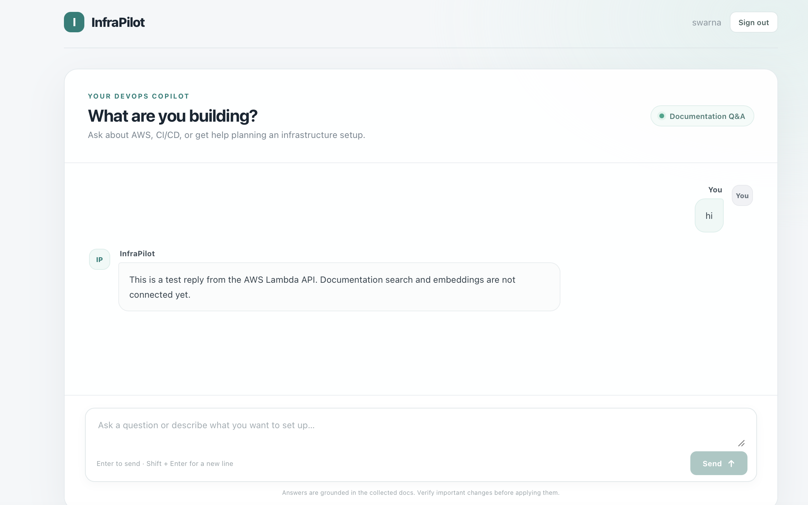

# InfraPilot frontend

A React + TypeScript + Vite chat interface with Cognito hosted sign-in and a session-based API.
On AWS the API is the InfraPilot assistant in a Lambda (`api/infrapilot_api/lambda_handler.py`):
answers are searched from the Bedrock Knowledge Base and written by OpenAI, and sessions are saved
in DynamoDB.

## Deployed demo

- **CloudFront website:** <https://d310825pit4l2e.cloudfront.net> (team account, deployed with
  CDK from `infra/`)
- **Sign-in:** Open the website and select its sign-in button. Users are created by the team in
  the Cognito console (self sign-up is off); do not publish or commit passwords or other credentials.

## Screenshots

### Cognito authentication page


### CloudFront-hosted chat interface



The screenshots are stored in `frontend/docs/images/`. Keep them free of passwords, tokens,
email addresses, and other private account information.

## AWS components

| Component | Purpose |
|---|---|
| S3 | Stores the built HTML, JavaScript, CSS, and other static frontend assets. |
| CloudFront | Serves the S3 site through the public website domain. |
| Cognito | Authenticates users through its hosted sign-in experience. |
| API Gateway | Exposes the session API routes and validates Cognito JWTs. |
| Lambda | Runs the chat API: the assistant, document search, and session storage. |
| DynamoDB | Stores user-scoped session and message records. |

See [`../api/README.md`](../api/README.md) for the API and [`../infra/README.md`](../infra/README.md)
for the AWS setup.

## Build and deploy the frontend

The AWS resources are defined in CDK; see [`../infra/README.md`](../infra/README.md). To deploy:

```bash
npm ci && npm run build
cd ../infra && npx aws-cdk@2 deploy
```

The deploy uploads `dist/`, clears the CloudFront cache, and writes `config.json` next to the
site with the Cognito and API settings. The app reads `config.json` at startup, so the deployed
site needs no `.env` file and no rebuild when an ID changes.

To run locally:

```bash
npm install
npm run dev
```

Open <http://localhost:5173>. Without a `.env.local`, the app calls the local FastAPI app at
`http://127.0.0.1:8000`; Cognito sign-in needs the `VITE_COGNITO_*` values from the stack outputs
(copy `.env.example` to `.env.local`, which is git-ignored).

`VITE_` values and `config.json` are public. Never put a client secret, password, AWS access key,
or other private credential in them. The Cognito app client is a public client with no secret.

## Backend connection

The frontend gets a Cognito access token and sends it as a bearer token with API requests. The
API Gateway HTTP API JWT authorizer should use:

- **Issuer:** `https://cognito-idp.<region>.amazonaws.com/<user-pool-id>`
- **Audience:** the public SPA app client ID (not a client with a secret)
- **Identity source:** `$request.header.Authorization`

Attach the authorizer to the session routes. Allow the exact CloudFront origin in API Gateway
CORS; allow `http://localhost:5173` as well if testing locally. Allow `GET`, `POST`, and
`OPTIONS`, and the `Authorization` and `Content-Type` headers.

The current frontend uses these routes:

- `POST /sessions` to create a session
- `GET /sessions/{session_id}` to restore it
- `POST /sessions/{session_id}/messages` to send a message

Locally, without `VITE_API_URL`, the app talks to the FastAPI app (`infrapilot-api`) at
`http://127.0.0.1:8000`, which serves the same routes.

## Errors encountered and resolutions

| Symptom | Resolution |
|---|---|
| CloudFront domain did not open the app | Set the CloudFront default root object to `index.html`. |
| Cognito login showed username/password but not email | Configure the appropriate user-pool sign-in options and hosted-login scopes (for example, `openid`, `email`, and `profile` as needed). |
| Cognito configuration was missing in the frontend | Set the `VITE_COGNITO_*` values in `.env.local`, rebuild, and upload the complete new `dist/` output. |
| Blank page or JavaScript error after login | Inspect the browser console and requested asset URLs. Verify the uploaded `index.html` references files present in S3, then invalidate CloudFront if it is serving stale HTML/assets. |
| Chat showed “The chat API is not configured yet” | Set `VITE_API_URL` to the API Gateway invoke URL and rebuild/redeploy the frontend. |
| Message API returned HTTP 500 | Check Lambda CloudWatch logs and environment variables. A leading space in `TABLE_NAME` caused DynamoDB's table-name validation to fail; use the exact table name with no surrounding whitespace. |

## Things to explore next

- Enable Cognito self-registration if appropriate.
- Customize the Cognito hosted-login branding.
- Replace the fixed Lambda response with the actual assistant/API integration.
- Improve error handling and add operational monitoring before broader use.
